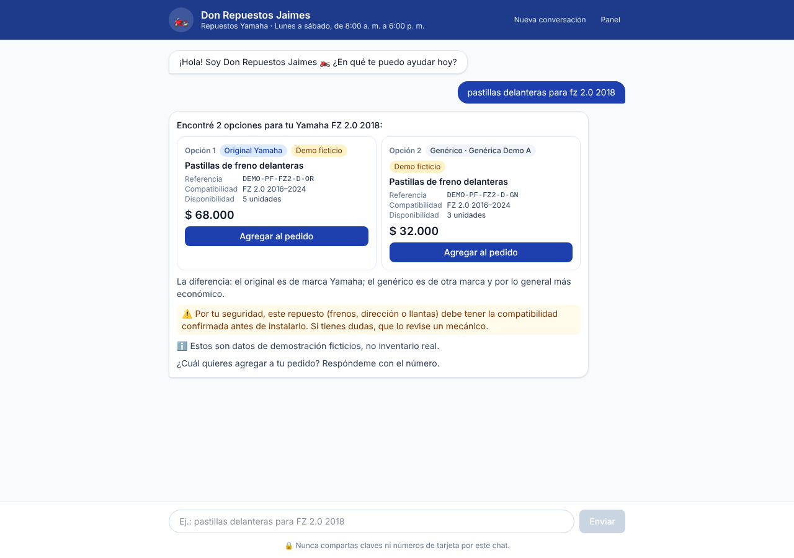
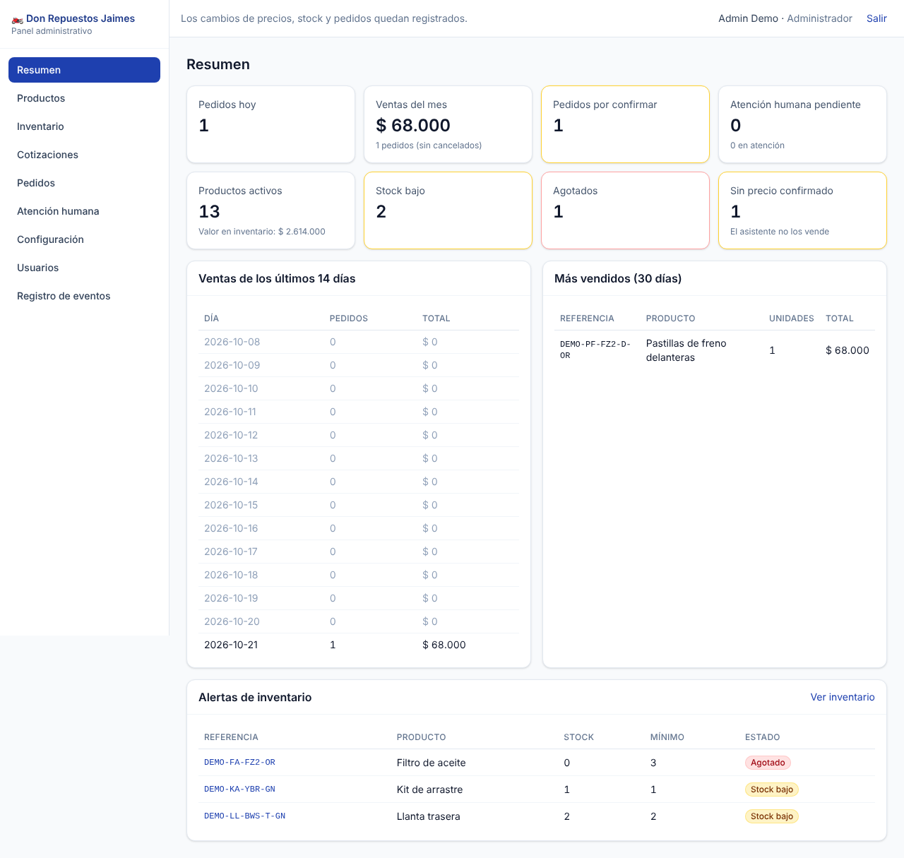
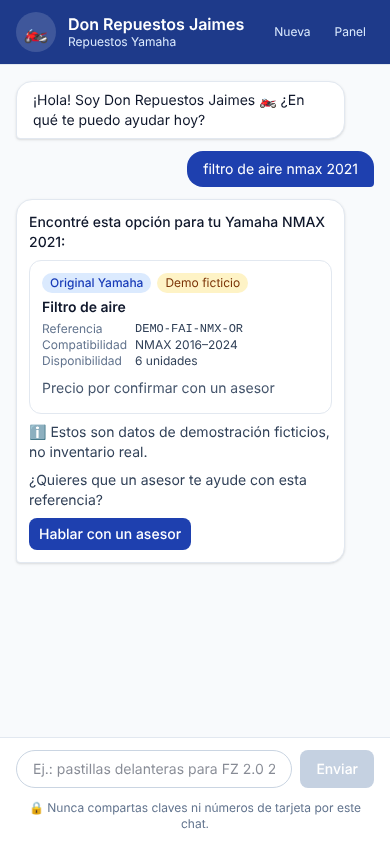
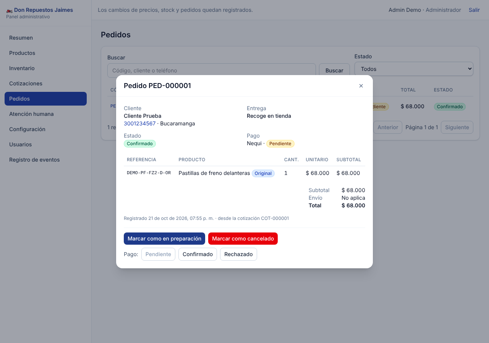

# Don Repuestos Jaimes 🏍️

Asistente virtual de ventas de repuestos para motos **Yamaha** en Colombia, con panel administrativo, inventario, cotizaciones, pedidos y atención humana.

> **Datos de demostración:** el proyecto trae productos FICTICIOS (referencias `DEMO-*`) para probar. No son el inventario real del negocio. Bórralos con `database/seeds/borrar_demo.sql` antes de cargar el inventario real.

## ¿Qué hace?

- **Chat para clientes** (web, y WhatsApp/Telegram vía n8n): identifica la moto (modelo + año), aclara el repuesto, consulta el inventario real, muestra precio/stock/compatibilidad, arma cotización y registra el pedido solo con confirmación explícita.
- **Nunca inventa datos:** todo sale de PostgreSQL. Si falta el precio, la compatibilidad no está verificada o no hay stock, lo dice y ofrece un asesor.
- **Panel administrativo** con roles (admin, vendedor, consulta): productos, compatibilidades, inventario con bitácora, alertas, cotizaciones, pedidos, atención humana, configuración del negocio, usuarios y registro de eventos.
- **Seguridad:** validación en servidor, JWT + bcrypt, roles verificados en backend, consultas parametrizadas, límite de solicitudes, webhooks firmados con HMAC, idempotencia y control de concurrencia en pedidos.

## Arquitectura en 30 segundos

```
Cliente ─▶ Chat web (React) ──────────────┐
Cliente ─▶ WhatsApp/Telegram ─▶ n8n ──────┤  (firma HMAC)
                                          ▼
                              Backend Express + TypeScript
                     (motor del asistente + módulos de negocio)
                                          ▼
                                    PostgreSQL
Asesor ─▶ Panel admin (React) ─▶ Backend (JWT + roles)
```

Monolito modular: un solo backend, dividido por módulos (`catalogo`, `cotizaciones`, `pedidos`, `escalamiento`, `conversaciones`, `clientes`, `auth`, `eventos`, `negocio`). Más detalle en [docs/PLAN_TECNICO.md](docs/PLAN_TECNICO.md).

## Requisitos

- Node.js 20 o superior (probado con 22)
- PostgreSQL 14 o superior (probado con 16)
- (Opcional) n8n para WhatsApp/Telegram

## Instalación paso a paso

```bash
# 1. Dependencias (backend + frontend, desde la raíz)
npm install

# 2. Base de datos
createdb drj                 # o créala desde pgAdmin

# 3. Variables de entorno del backend
cp backend/.env.example backend/.env
#   - Edita DATABASE_URL
#   - Genera JWT_SECRET:
node -e "console.log(require('crypto').randomBytes(48).toString('hex'))"

# 4. Crear tablas y (opcional) datos FICTICIOS de prueba
npm run db:migrar
npm run db:demo

# 5. Crear el primer administrador (la contraseña no queda en el código)
ADMIN_NOMBRE="Tu nombre" ADMIN_EMAIL="tu@correo.com" ADMIN_PASSWORD="UnaClaveLarga2026" npm run crear-admin
#   En Windows PowerShell:
#   $env:ADMIN_EMAIL="tu@correo.com"; $env:ADMIN_PASSWORD="UnaClaveLarga2026"; npm run crear-admin

# 6. Arrancar (dos terminales)
npm run dev:backend          # API en http://localhost:4000
npm run dev:frontend         # Web en http://localhost:5173
```

- Chat de clientes: http://localhost:5173/
- Panel: http://localhost:5173/admin

Si prefieres Docker para PostgreSQL y n8n, hay un [docker-compose.yml](docker-compose.yml) de apoyo (ver nota en ese archivo).

## Publicar en GitHub Pages

GitHub Pages solo sirve archivos estáticos, así que ahí se publica **solo el frontend** (chat y panel). El backend y PostgreSQL necesitan otro hosting (ver [docs/PENDIENTES_PRODUCCION.md](docs/PENDIENTES_PRODUCCION.md)).

- El workflow [.github/workflows/github-pages.yml](.github/workflows/github-pages.yml) compila el frontend en cada cambio a `main` y lo publica en la rama `gh-pages`.
- En el repositorio: **Settings → Pages → Source: Deploy from a branch → `gh-pages` / (root)**.
- La página publicada usa el backend de Render (`https://drj-backend.onrender.com`). Para apuntar a otro, crea la variable `VITE_API_URL` (Settings → Secrets and variables → Actions → Variables) y vuelve a ejecutar el workflow; el backend debe tener `https://<usuario>.github.io` en `CORS_ORIGENES`.
- El plan gratis de Render se duerme tras unos 15 minutos sin uso: el chat muestra "Conectando…", reintenta solo y envía el mensaje del cliente apenas el servidor despierta.

## Probar

```bash
createdb drj_test            # base SEPARADA: las pruebas la borran y recrean
npm test                     # 62 pruebas (unitarias + integración contra PostgreSQL real)
```

Las pruebas cubren los 16 casos de aceptación del prompt (búsqueda, sin resultados, compatibilidad, incompatibilidad por año, original vs. genérico, agotado, precio faltante, stock insuficiente, cotización múltiple, totales, pedido sin confirmar, pedido registrado, error de BD, atención humana, permisos y concurrencia sobre la última unidad). Mapa caso → prueba en [docs/INFORME_FASES.md](docs/INFORME_FASES.md).

Para usar otra base de pruebas: `TEST_DATABASE_URL=postgres://... npm test`.

Conversación de ejemplo en el chat:

1. `pastillas delanteras para fz 2.0 2018` → muestra original y genérica con precio y stock.
2. `la 1` → la agrega.
3. Botón **Ver cotización** → cotización con totales calculados por el servidor.
4. Botón **Hacer pedido** → formulario → resumen → **Sí, confirmo** → pedido `PED-000001`.

Otros casos: `filtro de aire nmax 2021` (precio sin confirmar), `bujía xtz 125 2023` (año no compatible), `quiero hablar con un asesor` (escalamiento).

## Estructura

```
backend/
  src/asistente/        motor conversacional (extracción y flujo de ventas)
  src/modulos/          lógica de negocio por módulo
  src/rutas/            endpoints públicos, integraciones y admin
  src/scripts/          migrar, cargar demo, crear admin
  tests/                pruebas unitarias e integración
frontend/
  src/chat/             chat del cliente
  src/paginas/admin/    panel administrativo
database/
  migrations/           SQL versionado (se aplica en orden, una sola vez)
  seeds/                datos FICTICIOS y script para borrarlos
n8n/
  workflows/            flujos exportables (importar en n8n)
  generar_workflows.py  fuente de los flujos
docs/                   API, servicios externos, inventario, pendientes
```

## Documentación

| Documento | Para qué |
|---|---|
| [docs/API.md](docs/API.md) | Todos los endpoints, entradas y salidas |
| [docs/CONFIGURACION_SERVICIOS.md](docs/CONFIGURACION_SERVICIOS.md) | n8n, WhatsApp, Telegram, avisos a asesores |
| [docs/GUIA_INVENTARIO.md](docs/GUIA_INVENTARIO.md) | Cómo cargar productos, compatibilidades y stock reales |
| [docs/DESPLIEGUE_RENDER.md](docs/DESPLIEGUE_RENDER.md) | Publicar backend y base de datos en Render |
| [docs/PENDIENTES_PRODUCCION.md](docs/PENDIENTES_PRODUCCION.md) | Qué falta antes de salir a producción |
| [docs/VERIFICACION_ENTREGA.md](docs/VERIFICACION_ENTREGA.md) | Resultado de la verificación final para la entrega |
| [docs/INFORME_FASES.md](docs/INFORME_FASES.md) | Resumen de cada fase, decisiones y errores encontrados |
| [docs/PLAN_TECNICO.md](docs/PLAN_TECNICO.md) | Análisis, arquitectura y riesgos |

## Capturas

| Chat | Panel |
|---|---|
|  |  |
|  |  |
