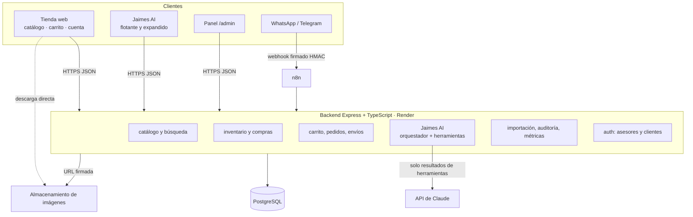
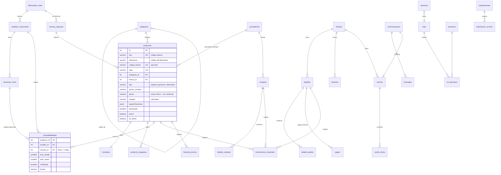
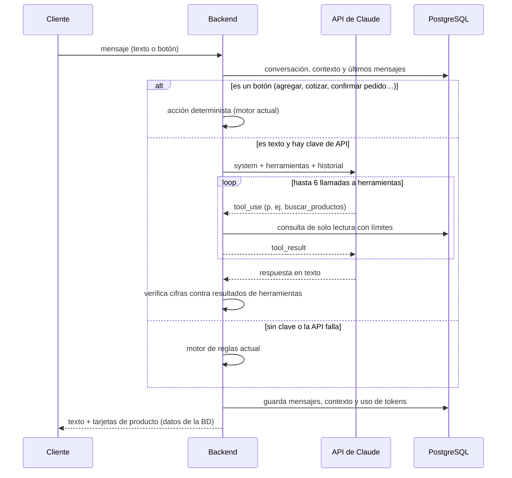
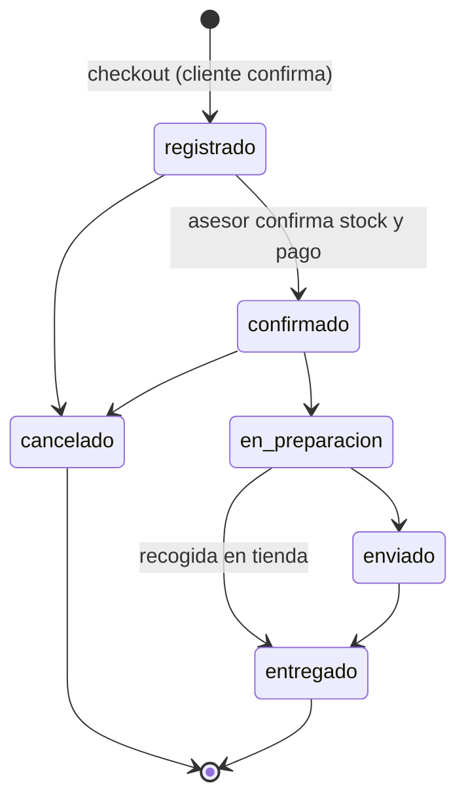

# Arquitectura — Don Repuestos Jaimes multimarca (Fase 2)

Este documento define cómo pasa Don Repuestos Jaimes de un asistente de ventas Yamaha a una plataforma multimarca con catálogo público, carrito, panel de inventario completo y el asistente **Jaimes AI**. Es el contrato técnico de las fases 3 a 8: lo que no esté aquí no se construye sin acordarlo antes.

Parte de la auditoría de la fase 1 (resumen en [§ 17](#17-hallazgos-de-la-fase-1-que-este-diseño-corrige)).

**Principios**

1. **Evolucionar, no reescribir.** Se conserva el stack (Express + TypeScript, PostgreSQL, React + Vite + Tailwind). Las 62 pruebas actuales deben seguir pasando en cada fase.
2. **Una sola fuente de verdad.** Precios, stock, compatibilidades y textos comerciales viven en PostgreSQL. Ningún componente del frontend trae productos o precios escritos.
3. **Nada se inventa.** Si un dato falta (precio, compatibilidad, foto), la interfaz y el asistente lo dicen. Los datos de demostración siempre llevan `es_demo = true` y referencias `DEMO-*`.
4. **Migraciones que extienden.** Las migraciones nuevas (`003+`) agregan y transforman; no borran datos existentes.
5. **Cada cambio de stock o precio deja rastro** con usuario, fecha y origen.

---

## 1. Vista general



- El frontend sigue publicado en **GitHub Pages**; el backend en **Render**.
- El LLM **no tiene acceso a la base de datos**: el backend ejecuta herramientas de solo lectura y le entrega sus resultados.
- Las imágenes se suben directo al almacenamiento con una URL firmada que emite el backend; la base de datos guarda solo la URL.

---

## 2. Decisiones de stack

| Tema | Decisión | Alternativa descartada y por qué |
|---|---|---|
| Backend | Express 4 + TypeScript + Zod + `pg` (actual) | Spring Boot: reescribir el backend y sus 62 pruebas no agrega funcionalidad; el patrón ya separa rutas (controladores), servicios, validación (DTOs con Zod) y errores globales |
| Acceso a datos | SQL parametrizado con `pg` + servicios por módulo | ORM (Prisma, TypeORM): el esquema ya usa `CHECK`, FK compuestas, vistas y triggers que un ORM esconde |
| Base de datos | PostgreSQL 16 | MySQL: perderíamos `JSONB`, `unaccent`, `pg_trgm`, índices parciales y `pgvector` |
| Búsqueda | `pg_trgm` + texto completo en español dentro de PostgreSQL | Elasticsearch/Meilisearch: otro servicio que pagar y sincronizar; innecesario hasta cientos de miles de productos |
| LLM | API de Claude con el SDK oficial `@anthropic-ai/sdk` | — |
| Frontend | React 18 + Vite + Tailwind 4 + framer-motion (actual) + TanStack Query para datos del servidor | Next.js: GitHub Pages no ejecuta servidor; no aporta aquí |
| Gráficos del panel | Recharts, solo en el chunk del panel | D3 a mano: más código para el mismo resultado |
| CSV / Excel | `csv-parse` / `csv-stringify` y `exceljs` en el backend | Procesar en el navegador: la validación debe ser del servidor |
| Imágenes | Supabase Storage (adaptador intercambiable por Cloudinary o S3) | Base64 en la BD: prohibido por el prompt y lento |
| Subida de archivos | `multer` en memoria, máximo 10 MB, solo para importaciones | — |

Dependencias nuevas del backend: `@anthropic-ai/sdk`, `cookie-parser`, `multer`, `csv-parse`, `csv-stringify`, `exceljs`, `@supabase/supabase-js`. Del frontend: `@tanstack/react-query`, `recharts`.

---

## 3. Modelo de datos

### 3.1 Diagrama entidad-relación

Solo columnas clave; los tipos completos van en las migraciones.



### 3.2 Tablas y cambios

**Se conservan sin cambios de fondo:** `inventario`, `movimientos_inventario` (se agrega `compra_id`), `cotizaciones`, `detalle_cotizacion`, `conversaciones`, `mensajes`, `transferencias_atencion`, `registros_eventos`, `configuracion_negocio`.

| Tabla | Estado | Contenido y reglas |
|---|---|---|
| `fabricantes_moto` | Nueva | Yamaha, Honda, Suzuki, Bajaj, AKT, TVS, Hero, Kawasaki, KTM, BMW Motorrad, Kymco, Royal Enfield, Victory… `nombre` único, `slug`, `logo_url` opcional, `activo` |
| `modelos_motocicleta` | Cambia | `fabricante` (texto) pasa a `fabricante_id` FK. Se mantienen `cilindraje_cc`, años y `alias`. Único por (fabricante_id, nombre). Se agrega `tipo_moto` (calle, scooter, enduro, deportiva, otro) |
| `versiones_moto` | Nueva | Variantes de un modelo cuando cambian piezas: "ABS", "FI", "2.0"… con `anio_desde`, `anio_hasta`, `cilindraje_cc`, `alias`. Opcional: un modelo sin versiones funciona igual |
| `categorias` | Nueva | Árbol (`padre_id`): Motor › Pistones, Frenos › Pastillas… `slug`, `nombre`, `sinonimos TEXT[]`, `requiere_posicion`, `es_seguridad`, `icono`, `orden`, `es_mantenimiento`. Reemplaza la lista fija de `categorias.ts` |
| `marcas_repuesto` | Renombrada (`marcas`) | Marca del fabricante del repuesto. Se quita la columna `tipo`; se agrega `fabricante_moto_id` (no nulo cuando la marca es la de la moto: "Yamaha Genuine Parts" → Yamaha) |
| `proveedores` | Nueva | `nombre`, `nit`, contacto, teléfono, correo, ciudad, `activo`, notas |
| `productos` | Cambia | Ver § 3.3 |
| `producto_imagenes` | Nueva | `url`, `clave_almacenamiento`, `alt`, `orden`, `es_principal` (una sola por producto, índice único parcial) |
| `compatibilidades` | Cambia | Se agrega `version_id` (NULL = todas las versiones). Único por (producto, modelo, versión, años) |
| `compras` + `detalle_compras` | Nuevas | Compra a proveedor: `codigo` `COMP-000001`, estado `borrador → recibida` o `anulada`, factura del proveedor, costo unitario. **Recibir** una compra crea movimientos `entrada` y actualiza `precio_compra` en la misma transacción |
| `historial_precios` | Nueva | Precio de compra y de venta anterior y nuevo, `origen` (manual, importación, compra), usuario y fecha. Lo llena un trigger, así ningún camino lo salta |
| `auditoria` | Nueva | Bitácora genérica: tabla, id del registro, acción, usuario, `cambios JSONB` (solo campos que cambiaron), fecha. Trigger en productos, compatibilidades, categorías, fabricantes, modelos, configuración, asesores y roles |
| `roles`, `permisos`, `rol_permisos` | Nuevas | `asesores.rol` pasa a FK de `roles.clave`. Roles iniciales: `admin`, `vendedor`, `consulta` con los mismos permisos de hoy |
| `clientes` | Cambia | Se agregan `email` (único, opcional), `password_hash` (opcional), `ultimo_acceso`. Se sigue permitiendo comprar sin cuenta |
| `carritos` + `carrito_items` | Nuevas | Carrito en servidor (`id` UUID), de un visitante, un cliente o una conversación. Estados `activo`, `convertido`, `abandonado`. Reemplaza `contexto.carrito` del chat |
| `favoritos` | Nueva | (cliente_id, producto_id) |
| `tarifas_envio` | Nueva | Costo y días estimados por ciudad/departamento, `activo`. Reemplaza la clave `costo_envio` de configuración |
| `pedidos` | Cambia | Se agregan `carrito_id`, `canal` (web, chat, whatsapp, telegram, panel), `whatsapp_enviado_at` |
| `pagos` | Nueva (preparada) | `proveedor` (manual, wompi, payu), referencia externa, monto, estado, `payload JSONB`. Hoy solo la usa el registro manual del asesor |
| `promociones` | Nueva | Porcentaje o valor fijo sobre producto, categoría o marca, con vigencia. El precio final lo calcula el servidor |
| `importaciones` + `importacion_errores` | Nuevas | Tipo (productos, precios, stock, compatibilidades), archivo, estado, contadores, y una fila por error (fila, columna, mensaje) |

**No se crean ahora** (con justificación): `listas_precios` (no hay venta mayorista; el precio público vive en `productos.precio` y se agrega si aparece ese caso), `bodegas` (hay un solo punto de stock), `detalle_mensajes` (los mensajes ya guardan `metadata JSONB`).

### 3.3 Productos

| Campo | Tipo | Regla |
|---|---|---|
| `sku` | `VARCHAR(60)` | Código interno único (sin importar mayúsculas). En la migración se copia de la `referencia` actual |
| `referencia` | `VARCHAR(60)` | Número de parte del fabricante; puede repetirse entre marcas |
| `codigo_barras` | `VARCHAR(40)` | Opcional, único si existe |
| `slug` | `VARCHAR(180)` | Para la URL pública `/producto/:slug` |
| `categoria_id` | FK | Reemplaza `categoria` (texto); la migración la llena desde la clave actual |
| `marca_id` | FK | Conserva el nombre; ahora apunta a `marcas_repuesto` |
| `tipo` | `original \| generico \| alternativo` | Ya no depende de la marca. `original` si y solo si la marca tiene `fabricante_moto_id`; lo valida un trigger de la BD (`ck_producto_original_oem`) |
| `precio_compra` | `NUMERIC(14,2)` | Opcional, ≥ 0. Solo visible en el panel |
| `precio` | `NUMERIC(14,2)` | Precio de venta en COP. `NULL` = sin confirmar: no se muestra ni se vende |
| `margen` | `NUMERIC(6,2)` generado | `(precio − precio_compra) / precio × 100` cuando ambos existen |
| `especificaciones` | `JSONB` | Pares clave-valor libres (viscosidad, medida, voltaje…) |
| `posicion`, `descripcion`, `activo`, `es_demo`, `created_at`, `updated_at` | — | Igual que hoy |
| `destacado` | `BOOLEAN` | Alimenta la sección de destacados de la portada |
| `proveedor_id` | FK opcional | Proveedor principal |
| `busqueda` | `tsvector` | Mantenido por trigger (ver § 7) |

"Eliminar" un producto en el panel lo **desactiva** (`activo = false`). El borrado real solo existe para productos sin pedidos, cotizaciones ni movimientos.

### 3.4 Reglas de negocio que viven en la base de datos

- Dinero siempre `NUMERIC(14,2)`; cantidades enteras con `CHECK (>= 0)`.
- `total = subtotal + envío` en cotizaciones y pedidos (ya existe).
- `cantidad_nueva = cantidad_anterior + cantidad` en movimientos (ya existe).
- Toda modificación de `inventario.cantidad` pasa por la función de servicio que inserta el movimiento en la misma transacción. Un trigger rechaza `UPDATE inventario SET cantidad` cuando la transacción no fijó `app.movimiento_id` (defensa contra cambios manuales sin rastro).
- Los triggers de auditoría y de historial de precios leen el usuario de `current_setting('app.usuario_id', true)`, que el backend fija con `SET LOCAL` al abrir cada transacción de escritura.

---

## 4. API REST

Convenciones actuales que se mantienen: prefijo `/api`, respuesta `{ ok: true, data }` o `{ ok: false, error: { codigo, mensaje } }`, validación con Zod, paginación `?pagina=&tamano=` (máximo 100), `Idempotency-Key` en creaciones de pedidos. Los endpoints actuales siguen funcionando; los que cambian de forma conservan la ruta vieja hasta la fase 8.

### 4.1 Público (sin sesión)

| Método y ruta | Uso |
|---|---|
| `GET /api/catalogo/productos` | Listado con filtros `q`, `categoria`, `fabricante`, `modelo`, `version`, `anio`, `cilindraje`, `marca`, `tipo`, `precio_min`, `precio_max`, `disponible`, `orden` (relevancia, precio_asc, precio_desc, nombre, recientes) |
| `GET /api/catalogo/productos/:slug` | Detalle: imágenes, especificaciones, compatibilidades, disponibilidad (estado y cantidad) |
| `GET /api/catalogo/productos/:slug/relacionados` | Misma categoría y moto compatible |
| `GET /api/catalogo/destacados` | Productos con `destacado = true` y precio confirmado |
| `GET /api/catalogo/sugerencias?q=` | Autocompletar del buscador (productos, categorías, motos) |
| `GET /api/catalogo/categorias` | Árbol de categorías activas |
| `GET /api/catalogo/fabricantes` | Fabricantes activos |
| `GET /api/catalogo/fabricantes/:id/modelos` | Modelos con cilindraje y años |
| `GET /api/catalogo/modelos/:id/versiones` | Versiones y rango de años |
| `GET /api/envios/tarifas` | Ciudades y costos de envío confirmados |
| `GET /api/negocio` | Datos comerciales confirmados (ya existe) |
| `POST /api/carritos` | Crea un carrito anónimo; devuelve su `id` |
| `GET /api/carritos/:id` | Carrito con precios y stock **recalculados** en el servidor |
| `PUT /api/carritos/:id/items/:productoId` | Fija la cantidad (valida stock y precio confirmado) |
| `DELETE /api/carritos/:id/items/:productoId` | Quita un producto |
| `POST /api/carritos/:id/checkout` | Datos de cliente y entrega → pedido `PED-xxxxxx` con estado `registrado` y enlace de WhatsApp con el resumen. No marca pago |
| `GET /api/pedidos/seguimiento` | Código + teléfono (ya existe) |
| `POST /api/chat/conversaciones`, `POST/GET /api/chat/conversaciones/:id/mensajes` | Asistente (ya existen; la respuesta agrega tarjetas, § 6.5) |

### 4.2 Cliente (cookie de sesión de cliente)

| Método y ruta | Uso |
|---|---|
| `POST /api/clientes/registro` · `POST /api/clientes/sesion` · `DELETE /api/clientes/sesion` | Cuenta con correo y contraseña |
| `GET /api/clientes/yo` | Perfil |
| `GET /api/clientes/yo/pedidos` · `GET /api/clientes/yo/pedidos/:codigo` | Historial |
| `GET /api/clientes/yo/favoritos` · `PUT/DELETE /api/clientes/yo/favoritos/:productoId` | Favoritos |
| `POST /api/clientes/yo/carrito/fusionar` | Une el carrito anónimo con el de la cuenta al iniciar sesión |

### 4.3 Panel (cookie de sesión de asesor + permiso)

> **Estado (fase 4C):** todas las áreas de esta tabla funcionan. Las imágenes necesitan las credenciales de Supabase (o `ALMACENAMIENTO=local` en desarrollo). Las tarifas de envío ya se administran, pero el checkout sigue usando `costo_envio` de la configuración hasta la fase 7.

Cada ruta exige un permiso (§ 5.2). Las escrituras quedan en `auditoria`.

| Área | Rutas |
|---|---|
| Sesión | `POST /api/auth/login`, `POST /api/auth/logout`, `GET /api/auth/yo`, `PUT /api/auth/password` |
| Dashboard | `GET /api/admin/metricas` (ampliado: total, activos, agotados, stock bajo, valor del inventario a costo y a venta, ventas del día y del mes, pedidos pendientes, más vendidos, ventas por día, inventario por categoría) |
| Catálogo de motos | CRUD `/api/admin/fabricantes`, `/api/admin/modelos`, `/api/admin/versiones` |
| Categorías y marcas | CRUD `/api/admin/categorias`, `/api/admin/marcas`, `/api/admin/proveedores` |
| Productos | `GET/POST /api/admin/productos`, `GET/PUT /api/admin/productos/:id`, `PATCH /api/admin/productos/:id/estado`, `DELETE /api/admin/productos/:id` (solo sin historial), `GET /api/admin/productos/:id/precios` |
| Imágenes | `POST /api/admin/productos/:id/imagenes/firma` (URL firmada de subida), `POST /api/admin/productos/:id/imagenes` (registra la imagen subida), `PATCH` orden y principal, `DELETE` |
| Compatibilidades | Las actuales + `version_id` |
| Inventario | `POST/GET /api/admin/inventario/:productoId/movimientos` (actuales), `GET /api/admin/inventario/movimientos` (global con filtros), `GET /api/admin/inventario/alertas` |
| Compras | CRUD `/api/admin/compras`, `POST /api/admin/compras/:id/recibir`, `POST /api/admin/compras/:id/anular` |
| Masivos | `POST /api/admin/precios/masivo` (por porcentaje o valor, con filtros y vista previa) |
| Importación | `POST /api/admin/importaciones` (archivo CSV/XLSX → validación en seco), `GET /api/admin/importaciones/:id`, `GET /api/admin/importaciones/:id/errores.csv`, `POST /api/admin/importaciones/:id/aplicar`, `GET /api/admin/importaciones/plantillas/:tipo` |
| Exportación | `GET /api/admin/exportaciones/inventario?formato=csv\|xlsx` |
| Ventas | Cotizaciones, pedidos y atención humana (actuales) + `POST /api/admin/pedidos/:codigo/pagos` (registro manual) |
| Comercial | CRUD `/api/admin/promociones`, `/api/admin/envios/tarifas`; configuración (actual) |
| Usuarios | Asesores (actual) + `GET/PUT /api/admin/roles/:clave/permisos` |
| Auditoría | `GET /api/admin/auditoria`, `GET /api/admin/eventos` (actual) |

### 4.4 Integraciones (firma HMAC)

Sin cambios: `POST /api/integraciones/mensaje`, `/integraciones/eventos`, `/cotizaciones`, `/pedidos`, `/escalamientos`. WhatsApp y Telegram pasan por el mismo orquestador de Jaimes AI.

---

## 5. Autenticación y autorización

### 5.1 Sesiones

| | Asesores (panel) | Clientes (tienda) |
|---|---|---|
| Credencial | Correo + contraseña (bcrypt costo 12) | Correo + contraseña (bcrypt costo 12) |
| Token | JWT HS256, `aud: "panel"`, 8 h | JWT HS256, `aud: "tienda"`, 30 días |
| Transporte | Cookie `drj_panel`: `HttpOnly`, `Secure`, `SameSite=None` (frontend y backend en dominios distintos) | Cookie `drj_cliente`, mismos atributos |
| CSRF | `X-CSRF-Token` en toda escritura hecha con la cookie. El token es `HMAC(JWT_SECRET, "csrf:" + jwt)`: lo devuelven el login y `/yo` en el cuerpo (una cookie no `HttpOnly` no sirve porque el frontend está en otro dominio y no puede leerla) | Igual |
| Revocación | Se consulta `asesores.activo` y el rol en cada solicitud (como hoy) | Se consulta `clientes` en cada solicitud |
| Límites | 10 intentos de login / 15 min (actual) | Igual |

Mientras el panel actual se migra a cookies (fase 5), el login también devuelve el token en el cuerpo y el backend sigue aceptando `Authorization: Bearer` (lo usa n8n). Con `Bearer` no se pide CSRF, porque un sitio ajeno no puede poner ese encabezado.

El token deja de estar en `sessionStorage`: JavaScript no puede leerlo, así que un XSS no puede robarlo. Un token de cliente nunca abre rutas del panel (se verifica `aud`).

### 5.2 Permisos

Los permisos se verifican en el servidor con `requerirPermiso('productos.editar')`. La interfaz solo oculta botones como comodidad.

| Permiso | admin | vendedor | consulta |
|---|:-:|:-:|:-:|
| `catalogo.ver`, `inventario.ver`, `ventas.ver` | ✔ | ✔ | ✔ |
| `productos.editar`, `compatibilidades.editar`, `imagenes.editar` | ✔ | | |
| `precios.editar`, `precios.masivo` | ✔ | | |
| `inventario.mover`, `compras.gestionar` | ✔ | ✔ | |
| `importaciones.aplicar`, `exportaciones.descargar` | ✔ | | |
| `pedidos.gestionar`, `atencion.gestionar` | ✔ | ✔ | |
| `configuracion.editar`, `usuarios.gestionar`, `auditoria.ver` | ✔ | | |

Igual que hoy, editar productos, compatibilidades e imágenes queda solo para el administrador; el vendedor mueve inventario, registra compras y gestiona pedidos y atención.

Los roles se pueden ampliar desde el panel (`roles` y `rol_permisos`); la lista de permisos la define el código.

---

## 6. Jaimes AI

### 6.1 Flujo de un mensaje



### 6.2 Herramientas

Todas se ejecutan en el backend con Zod, consultas parametrizadas y máximo 8 resultados. El modelo nunca escribe SQL.

| Herramienta | Tipo | Qué hace |
|---|---|---|
| `identificar_moto` | Lectura | Texto libre → fabricante, modelo, versión y año candidatos (alias + trigramas) |
| `buscar_productos` | Lectura | Consulta, categoría, moto, tipo, precio máximo, solo disponibles → productos con precio, stock y compatibilidad |
| `consultar_producto` | Lectura | SKU → detalle, especificaciones, compatibilidades, disponibilidad |
| `verificar_compatibilidad` | Lectura | SKU + moto + año → compatible verificado, por confirmar o no compatible |
| `alternativas` | Lectura | SKU → productos de la misma categoría compatibles con la moto, ordenados por precio |
| `categorias_mantenimiento` | Lectura | Categorías marcadas `es_mantenimiento` por el administrador (no inventa intervalos de kilometraje) |
| `info_negocio` | Lectura | Horario, envíos, medios de pago confirmados |
| `agregar_al_carrito` | Acción acotada | SKU + cantidad sobre el carrito **de esta conversación**; valida stock y precio |
| `solicitar_asesor` | Acción acotada | Crea la transferencia a atención humana (servicio actual) |

Lo que el modelo **no** puede hacer: confirmar un pedido, marcar un pago, cambiar precios o stock, ni leer datos de otros clientes. La confirmación del pedido sigue siendo un botón (`confirmar_pedido`) que el cliente pulsa, como hoy.

### 6.3 Reglas del sistema (resumen del prompt)

- Español colombiano, tono cercano, respuestas cortas.
- Precios, stock, referencias, compatibilidades, descuentos y especificaciones **solo** de resultados de herramientas; si no hay dato, decirlo y ofrecer asesor.
- Pedir lo que falte (marca, modelo, año, versión o cilindraje) antes de recomendar; no volver a pedir lo que ya está en el contexto.
- En frenos, llantas y dirección, incluir la advertencia de seguridad.
- No pedir datos de tarjeta (el filtro actual de mensajes se mantiene).

**Verificación posterior:** antes de enviar, el backend busca montos en COP en el texto del modelo; si alguno no coincide con un precio devuelto por herramientas en ese turno, se reemplaza la respuesta por las tarjetas sin texto de precios y se registra un evento `ia_cifra_no_verificada`.

### 6.4 Memoria y contexto

- La moto identificada, la categoría en curso y el carrito siguen en `conversaciones.contexto` (JSONB) y se envían al modelo como un bloque de estado.
- El historial enviado es el de la conversación actual, guardado completo en `mensajes.metadata` (incluidos los bloques que devuelve la API) y reenviado sin modificarlo, como exige la API para los bloques de razonamiento.
- "Nueva conversación" cierra la actual y crea otra.
- Las conversaciones inactivas 7 días se cierran solas.

### 6.5 Tarjetas de producto

La respuesta del chat agrega `tipo: "productos"` con `datos` tomados de la base de datos (no del texto del modelo): imagen principal, nombre, marca, SKU y referencia, precio COP, disponibilidad, compatibilidad, tipo (original, genérico, alternativo), y botones **Ver producto** (`/producto/:slug`) y **Agregar al carrito** (acción `agregar` sobre el mismo carrito de la tienda). En WhatsApp y Telegram las tarjetas se convierten en texto.

### 6.6 Configuración y costo

| Variable | Valor inicial |
|---|---|
| `ANTHROPIC_API_KEY` | Secreto en Render. Sin ella, Jaimes AI usa el motor de reglas |
| `IA_MODELO` | `claude-opus-5-5` |
| `IA_ESFUERZO` | `low` (conversación de ventas; se mide antes de subirlo) |
| `IA_MAX_HERRAMIENTAS` | `6` llamadas por mensaje |
| `IA_LIMITE_DIARIO_MENSAJES` | Tope de mensajes con IA por día; al superarlo, motor de reglas |

Se usan caché de prompt (sistema y herramientas estables al inicio), `tool_choice: auto` y el respaldo de servidor `fallbacks: "default"` ante rechazos. Cada respuesta registra tokens de entrada, salida y caché en `mensajes.metadata` para ver el costo en el panel.

### 6.7 RAG (opcional, después de la fase 6)

Solo si el negocio tiene fichas técnicas o manuales reales: tabla `documentos_tecnicos` con `pgvector`, subida desde el panel y una herramienta `buscar_documentacion` que devuelve fragmentos con su fuente. No se construye sin documentos.

---

## 7. Búsqueda

- Extensiones `pg_trgm` y `unaccent` (esta ya existe), con una función `f_normalizar(text)` marcada `IMMUTABLE` para poder indexar.
- `productos.busqueda tsvector` (configuración `spanish`) con nombre (peso A), SKU y referencia (A), categoría y sinónimos (B), marca (B), descripción (C), mantenido por trigger.
- Índices GIN: `busqueda`, trigramas sobre `f_normalizar(nombre)`, `sku` y `referencia`.
- Orden por relevancia: coincidencia exacta de SKU/referencia/código de barras primero, luego `ts_rank`, luego similitud de trigramas (tolera "pastiyas", "bugia").
- El filtro por moto se resuelve con `EXISTS` sobre `compatibilidades` (modelo, versión nula o igual, año dentro del rango).
- Objetivo: menos de 150 ms por búsqueda con 50.000 productos; se mide en la fase 8 con datos sintéticos.

---

## 8. Imágenes

1. El panel pide `POST /admin/productos/:id/imagenes/firma` con tipo y tamaño (JPG, PNG o WebP, máximo 5 MB).
2. El backend responde una URL firmada de subida de un solo uso.
3. El navegador sube el archivo directo al almacenamiento.
4. El panel registra la imagen; el backend verifica que el objeto exista y guarda la URL pública.

Interfaz `AlmacenamientoImagenes` con dos adaptadores: `supabase` (producción) y `local` (desarrollo y pruebas, carpeta `backend/uploads`). Variables: `ALMACENAMIENTO=supabase|local`, `SUPABASE_URL`, `SUPABASE_SERVICE_KEY`, `SUPABASE_BUCKET`. Sin foto, la tarjeta muestra la ilustración de su categoría, identificada como ilustración.

---

## 9. Importación y exportación

Dos pasos para que nada se aplique a medias:

1. **Validar (en seco):** el archivo se lee completo, cada fila se valida con Zod (tipos, precios ≥ 0, cantidades enteras, categoría y marca existentes, años válidos) y se detectan SKU duplicados dentro del archivo y contra la base. Resultado: importación en estado `validada` o `con_errores` con el reporte por fila.
2. **Aplicar:** solo filas válidas (o todo-o-nada, a elección del administrador), en una transacción. Precios → `historial_precios` con origen `importacion`; stock → movimientos `ajuste` con motivo "Importación #id".

| Tipo | Columnas mínimas |
|---|---|
| Productos | sku, nombre, categoria, marca, tipo, precio, precio_compra, stock_minimo, referencia, codigo_barras, descripcion |
| Precios | sku, precio, precio_compra |
| Stock | sku, cantidad (absoluta) o diferencia, motivo |
| Compatibilidades | sku, fabricante, modelo, version, anio_desde, anio_hasta, verificada, fuente |

Límite inicial: 20.000 filas o 10 MB por archivo. Plantillas descargables desde el panel. La exportación del inventario usa los mismos encabezados que la importación de productos, así un archivo exportado se puede editar y volver a importar.

---

## 10. Carrito, pedidos y pagos



- El carrito siempre se recalcula en el servidor: precio vigente (con promoción), stock y precio confirmado.
- El checkout reutiliza `registrarPedido` (idempotencia, `FOR UPDATE`, venta de la última unidad probada).
- Envío: costo de `tarifas_envio` para la ciudad; si la ciudad no tiene tarifa, el pedido queda con envío "por confirmar" (regla actual `envio_confirmado`).
- **WhatsApp:** tras registrar el pedido, el cliente ve el número `PED-xxxxxx` y un botón que abre `wa.me/<número del negocio>` con el resumen. El número sale de `configuracion_negocio`.
- **Pagos:** `estado_pago` sigue en `pendiente` hasta que un asesor registra el pago manual. La tabla `pagos` y la interfaz `PasarelaPagos` (`crearIntencion`, `verificarWebhook`) quedan listas para Wompi o PayU; ningún flujo marca un pago como exitoso sin confirmación del proveedor o de un asesor.

---

## 11. Frontend

### 11.1 Rutas

> **Estado (fase 3):** implementado. Las páginas de la tienda (menos la portada) se descargan aparte con `lazy()`.

| Ruta | Página |
|---|---|
| `/` | Portada: "¿QUÉ NECESITAS PARA TU MOTO?", buscador con sugerencias, selector de moto (marca → modelo → año), marcas, categorías, destacados, Jaimes AI |
| `/catalogo` | Catálogo con filtros en la URL (se pueden compartir): `q`, `categoria`, `fabricante`, `modelo`, `anio`, `tipo`, `disponible`, `precio_min`, `precio_max`, `orden`, `pagina` |
| `/producto/:slug` | Fotos (o ilustración marcada como tal), precio y promoción, disponibilidad, compatibilidades verificadas / sin verificar, especificaciones, aviso de pieza de seguridad, cantidad, favoritos, relacionados |
| `/carrito`, `/checkout` | Carrito del servidor y confirmación del pedido (no cobra nada: pago "pendiente") |
| `/pedido/:codigo`, `/pedido` | Confirmación con botón de WhatsApp (solo si el número está configurado) y consulta con código + celular |
| `/ingresar`, `/cuenta` | Ingreso / registro y cuenta del cliente (pedidos, favoritos, cerrar sesión) |
| `/asistente` | Jaimes AI a pantalla completa (`/chat` redirige aquí) |
| `/admin/*` | Panel (carga diferida) |

La moto elegida se guarda en `localStorage` (`drj_moto`) solo como preferencia de interfaz; el catálogo la ofrece como filtro y la ficha de producto avisa si no hay compatibilidad registrada con ella. Del carrito el navegador solo recuerda el id (`drj_carrito`): precios, stock y promociones se recalculan en el servidor.

### 11.2 Estructura

```
frontend/src/
  api/            cliente (fetch + CSRF), tienda.ts (tipos y llamadas públicas), auth, formato
  tienda/         estado.tsx (carrito, moto, sesión, favoritos), ui.tsx, LayoutTienda, Buscador, SelectorMoto
    catalogo/     PaginaCatalogo (filtros, chips, orden, paginación)
    producto/     PaginaProducto
    carrito/      PaginaCarrito, PaginaCheckout, PaginaPedido
    cuenta/       PaginaIngresar, PaginaCuenta
  inicio/         portada (Hero, Secciones, imágenes)
  chat/           Jaimes AI (panel y página completa)
  paginas/admin/  panel
```

**Sesión de cliente entre dominios:** si la tienda (GitHub Pages) y la API (Render) están en dominios distintos, Safari y algunos navegadores bloquean la cookie de sesión de terceros. El carrito y la compra funcionan igual (no usan cookie); el ingreso de clientes necesita que ambos queden bajo el mismo dominio (por ejemplo `tienda.midominio.com` y `api.midominio.com`). Ver PENDIENTES_PRODUCCION.

### 11.3 Identidad visual

| Token | Valor |
|---|---|
| Fondo | `#05060A` |
| Azul eléctrico | `#2F6BFF` |
| Azul secundario | `#00D4FF` |
| Texto principal | `#FFFFFF` |
| Texto secundario | gris tecnológico `#8A94A6` |

3D: los renders WebP actuales y CSS 3D con parallax; Three.js solo si aporta y cargado de forma diferida después del contenido principal. Todas las animaciones respetan `prefers-reduced-motion`. Meta de rendimiento en celular: LCP < 2,5 s, bundle inicial de la tienda < 180 kB comprimido.

---

## 12. Backend: estructura

```
backend/src/
  app.ts, server.ts, config.ts, db.ts, errores.ts
  middleware/     auth (sesión panel y cliente), permisos, csrf, firmaWebhook, contextoUsuario (SET LOCAL)
  modulos/
    catalogo/     motos, categorias, marcas, productos, busqueda, compatibilidad
    inventario/   movimientos, alertas, compras, proveedores
    ventas/       carrito, cotizaciones, pedidos, envios, promociones, pagos (pasarela)
    clientes/     cuentas, favoritos
    importacion/  lectores (csv, xlsx), validadores, aplicadores, exportacion
    imagenes/     almacenamiento (supabase, local)
    asistente/    motor de reglas (actual), ia/ (orquestador, herramientas, prompt, verificador)
    auth/, negocio/, eventos/, auditoria/, metricas/
  rutas/          publicas/, cliente/, admin/ (un archivo por área), integraciones
  scripts/        migrar, cargarDemo, crearAdmin, prepararDespliegue
```

Cada módulo expone servicios con SQL; las rutas solo validan, llaman al servicio y responden. `rutas/admin.ts` (625 líneas hoy) se divide por área y su SQL pasa a los servicios.

---

## 13. Migraciones

| Archivo | Contenido |
|---|---|
| `003_catalogo_multimarca.sql` | `fabricantes_moto` (+ carga de las 13 marcas), `fabricante_id` en modelos con relleno desde el texto actual, `versiones_moto`, `categorias` (+ carga desde las 12 claves actuales y el árbol nuevo), renombre `marcas → marcas_repuesto`, columnas nuevas de productos con relleno (`sku ← referencia`, `categoria_id ← categoria`), `version_id` en compatibilidades |
| `004_compras_imagenes.sql` | Compras, detalle, `compra_id` en movimientos, imágenes (los proveedores se crean en 003) |
| `005_auditoria_precios.sql` | `auditoria`, `historial_precios`, triggers, protección de `inventario.cantidad` |
| `006_roles_permisos.sql` | Roles, permisos y matriz inicial; FK desde `asesores.rol` |
| `007_clientes_carrito.sql` | Cuenta de cliente, carritos, favoritos, `canal` y `carrito_id` en pedidos, `pagos` |
| `008_comercial.sql` | Promociones y tabla `tarifas_envio` (vacía: el costo sigue saliendo de `costo_envio` en configuración, que el dueño aún no confirma; el servicio pasará a la tabla en la fase 7) |
| `009_importaciones.sql` | Importaciones y errores |
| `010_busqueda.sql` | `pg_trgm`, `f_normalizar`, `busqueda tsvector`, índices |
| `011_tienda.sql` | `clientes.cuenta_creada_at` (el historial de la cuenta solo muestra pedidos hechos desde que se abrió, porque el teléfono no se verifica por SMS), clave `whatsapp_ventas` sin confirmar, reindexación de la búsqueda al cambiar nombre o sinónimos de una categoría o marca, `fuzzystrmatch` + `f_coincide_aprox` para errores de digitación ("bugia" → bujía) |
| `012_promociones_vigentes.sql` | Vista `v_precio_vigente`: el precio que se cobra (con la mejor promoción vigente, sin sumar descuentos, nunca ≤ 0 ni para productos sin precio). La usan catálogo, carrito, asistente y pedido |

Las columnas viejas (`productos.categoria`, `modelos_motocicleta.fabricante`, `marcas.tipo`) se rellenan en sus reemplazos y se quitan en la misma migración 003, porque en el mismo pull request todo el código se adaptó. Las migraciones se prueban de dos formas: sobre una base vacía y sobre una base con el esquema 001–002 y los datos demo anteriores (como está hoy en Render).

**Datos de demostración:** `database/seeds/demo_ficticio.sql` (reescrito) con varios fabricantes, modelos reales con años **sin verificar** (los nuevos con `es_demo = true`), productos `DEMO-*` de varias categorías con precios ficticios en COP, stock y compatibilidades marcadas como no verificadas. `borrar_demo.sql` se actualiza para limpiar todo lo nuevo.

---

## 14. Seguridad

Lo actual se mantiene (Zod, SQL parametrizado, bcrypt, helmet, CORS cerrado, límites de solicitudes, HMAC). Se agrega:

- Cookies `HttpOnly` + CSRF (§ 5.1) y permisos por acción (§ 5.2).
- CSP estricta en la tienda: solo el backend, el almacenamiento de imágenes y las fuentes propias.
- Textos de usuario renderizados siempre como texto en React (nunca `dangerouslySetInnerHTML`); descripciones de producto en texto plano.
- Validación de archivos de importación por contenido (no solo extensión) y límite de tamaño.
- Límites específicos: chat con IA por conversación e IP, búsqueda pública, checkout.
- La clave de la API de IA y la del almacenamiento existen solo en el backend.
- Auditoría de toda escritura del panel con usuario e IP.

---

## 15. Despliegue

| Pieza | Hoy | Propuesta |
|---|---|---|
| Frontend | GitHub Pages vía workflow | Igual |
| Backend | Render free (se duerme) | Render; plan pago antes de producción para evitar el arranque en frío de ~1 min |
| PostgreSQL | Render free (vence) | PostgreSQL gestionado con respaldos diarios (Supabase o Neon) o Render pago |
| Imágenes | — | Supabase Storage, bucket público de lectura |
| IA | — | API de Claude, clave en Render |

Variables nuevas del backend: `ANTHROPIC_API_KEY`, `IA_MODELO`, `IA_ESFUERZO`, `IA_MAX_HERRAMIENTAS`, `IA_LIMITE_DIARIO_MENSAJES`, `ALMACENAMIENTO`, `SUPABASE_URL`, `SUPABASE_SERVICE_KEY`, `SUPABASE_BUCKET`, `COOKIE_DOMINIO`. `render.yaml` y `docs/DESPLIEGUE_RENDER.md` se actualizan en la fase 8.

---

## 16. Pruebas

| Nivel | Herramienta | Qué cubre |
|---|---|---|
| Unitarias | Vitest | Normalización, cálculo de precios y promociones, validadores de importación, verificador de cifras de la IA |
| Integración | Vitest + Supertest + PostgreSQL real (como hoy) | Cada endpoint nuevo, permisos por rol, auditoría, importación con errores, checkout concurrente |
| Asistente | Vitest con cliente de Claude simulado | Las herramientas se llaman con datos válidos; el asistente no muestra cifras que no vienen de la BD; respaldo por reglas sin clave |
| Frontend | Vitest + Testing Library | Filtros, carrito, formularios |
| E2E | Playwright versionado en `e2e/` | Buscar → producto → carrito → pedido; Jaimes AI agrega al carrito; panel crea producto e importa CSV |

---

## 17. Hallazgos de la fase 1 que este diseño corrige

| Hallazgo | Dónde se corrige |
|---|---|
| Todo el sistema asume Yamaha | § 3.2 (`fabricantes_moto`, `marcas_repuesto`), § 11 |
| "Original" atado a la marca y no al fabricante de la moto | § 3.3 (`tipo` independiente + regla en servicio) |
| Categorías fijas en código | § 3.2 (`categorias` con sinónimos) |
| El asistente no entiende lenguaje libre | § 6 |
| Sin catálogo público ni carrito fuera del chat | § 4.1, § 10, § 11 |
| Faltan SKU, costo, proveedor, imágenes, especificaciones | § 3.3, § 8 |
| Sin importación, historial de precios ni auditoría general | § 3.2, § 9 |
| Métricas del mes en UTC y no en hora de Bogotá | Se corrige en la fase 5 junto con el dashboard ampliado |
| Token del panel en `sessionStorage` | § 5.1 |
| Panel en tema claro distinto a la tienda | § 11.1 |
| `rutas/admin.ts` con SQL dentro | § 12 |

## 18. Lo que depende de servicios externos

| Funcionalidad | Necesita | Sin eso |
|---|---|---|
| Jaimes AI con lenguaje natural | Clave de API de Claude | Funciona con el motor de reglas actual |
| Subida de imágenes | Proyecto de Supabase (o Cloudinary) | Adaptador `local` en desarrollo; en producción, productos sin foto |
| Pedido por WhatsApp | Número de WhatsApp del negocio | Pedido registrado y aviso al asesor como hoy |
| Pasarela de pagos | Cuenta Wompi o PayU | Pago manual registrado por un asesor |
| Producción estable | Plan pago de Render y BD con respaldos | Demo en plan gratis |
